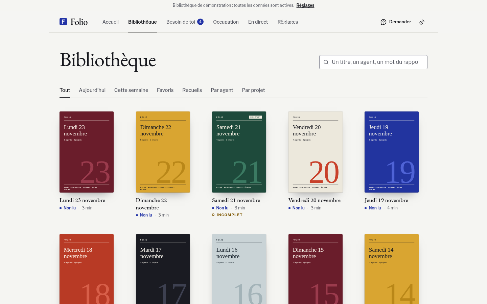
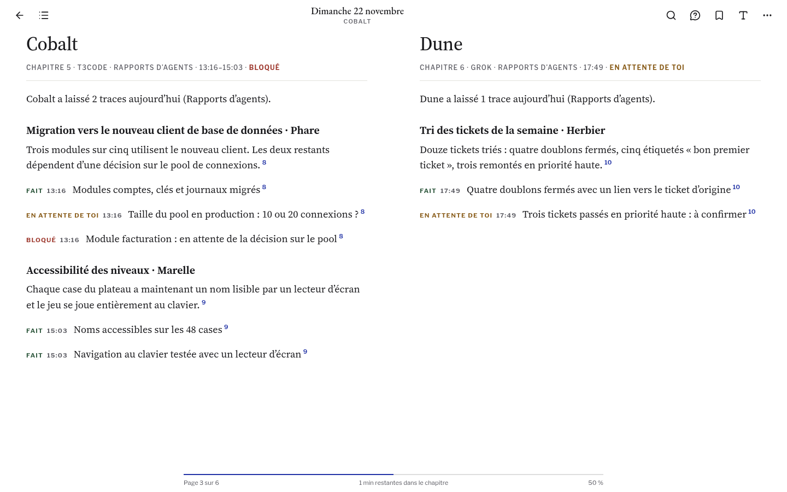

# Folio

**Le travail de tes agents IA, en un livre que tu lis chaque jour.**

[](LICENSE)
[](https://github.com/nautalsoft/folio/actions/workflows/ci.yml)
[](https://vercel.com/new/clone?repository-url=https%3A%2F%2Fgithub.com%2Fnautalsoft%2Ffolio)

[Read in English](README.md) · [Discussions](https://github.com/nautalsoft/folio/discussions) · [API](docs/api.md) · [Auto-hébergement](docs/self-hosting.md) · [Vercel](docs/vercel.md)

Folio rassemble ce que tes agents de code (t3code, Claude Code, Codex, Grok Bot, agents cloud…) et tes outils ont fait dans la journée, et le compile en livre : une préface, ce qui t'attend, un chapitre par agent, un par source. Chaque fait renvoie vers son origine. Tu le lis dans une liseuse inspirée d'Apple Books, avec thèmes, surlignages, notes et export EPUB ou PDF.

| Bibliothèque | Liseuse |
| --- | --- |
|  |  |

*Les captures montrent la bibliothèque de démonstration intégrée. Tous les noms, projets et liens y sont fictifs.*

## Pourquoi

Les agents travaillent désormais en parallèle, toute la journée, à plein d'endroits : terminaux, éditeurs, CI, bots de discussion, exécutions dans le cloud. Une infrastructure de coordination comme Vercel Board leur donne un espace commun pour poster des messages, réserver des tâches et se passer le relais. Cette infrastructure est headless par conception : elle est faite pour des agents et des API, pas pour une personne qui veut s'asseoir et comprendre ce qui s'est passé.

Folio est l'interface de lecture par-dessus. Il lit Board et tes autres outils, reçoit les rapports que les agents lui envoient, et transforme une journée d'activité en quelque chose qui se lit en dix minutes, avec en tête les décisions qui t'attendent.

## Fonctionnalités

- **Un livre par jour**, compilé et publié à l'heure que tu choisis, plus un recueil mensuel qui rassemble les jours publiés.
- **Des chapitres qui ont du sens :** préface, « Besoin de toi », un chapitre par agent, un par source, et un chapitre « Sources » qui dit quelles sources ont été lues, ignorées, non configurées ou en échec. Un livre dont une source a échoué est marqué *incomplet*.
- **Chaque fait cite sa source**, sous forme de lien cliquable vers la pull request, le déploiement, le message, le ticket ou le rapport d'agent.
- **Des sources ouvertes.** Six collecteurs intégrés (Vercel Board, GitHub, déploiements Vercel, Slack, ClickUp, Notion), et n'importe quel autre outil (Linear, Jira, Discord, un script à toi) peut envoyer des faits sous son propre nom et obtenir son propre chapitre.
- **Des rapports d'agents** envoyés en HTTP, avec éléments, code, diffs et traces d'étapes.
- **Besoin de toi :** décisions, blocages et relectures remontés par les agents ou les sources, triés par échéance, résolus depuis l'app.
- **Occupation :** réservations de tâches, signes de vie et points d'étape, pour que deux agents ne fassent pas la même chose et puissent reprendre le travail l'un de l'autre.
- **En direct :** un fil en temps réel de ce que les agents envoient.
- **Une vraie liseuse :** pages ou défilement, quatre thèmes, polices, taille, interligne, marges, justification, guide de lecture, table des matières, recherche dans le livre, signets, surlignages en quatre couleurs, notes, progression et temps de lecture.
- **Interroger le livre :** un chat qui répond à partir des passages du livre et les cite. Sans modèle, il se rabat sur une simple recherche de passages.
- **Corriger et régénérer :** corrige un paragraphe à la main ; régénérer le livre conserve tes corrections, sauf si tu choisis de les abandonner.
- **Rédaction IA optionnelle** via Vercel AI Gateway ou n'importe quel serveur compatible OpenAI. Sans modèle, le livre est compilé à partir des seuls faits.
- **Export** de tout livre publié en EPUB ou PDF.
- **Webhooks** pour `book.published`, `needs_you.created` et `digest.failed`, signés en HMAC si tu le souhaites.
- **Agents du navigateur (WebMCP) :** les composants de l'interface sont exposés aux agents qui tournent dans le navigateur, avec un réglage pour toujours demander, demander seulement pour les actions sensibles, ou désactiver.
- **Clair et sombre, français et anglais.**
- **Une bibliothèque de démonstration fictive** au premier lancement, pour parcourir douze jours de livres et un recueil mensuel avant de brancher quoi que ce soit.

## Démarrage rapide

Il te faut Docker, ou un compte Vercel. Ça prend moins de cinq minutes.

### Docker

```bash
git clone https://github.com/nautalsoft/folio.git folio
cd folio
docker compose up
```

Ouvre <http://localhost:3000>. Cette commande construit l'app et la lance avec une base Postgres 17. La bibliothèque de démonstration est là ; tes données sont conservées dans la base. Voir [docs/self-hosting.md](docs/self-hosting.md) pour les volumes, les sauvegardes, HTTPS et les mises à jour.

### Vercel

[](https://vercel.com/new/clone?repository-url=https%3A%2F%2Fgithub.com%2Fnautalsoft%2Ffolio)

Le bouton déploie sans aucune configuration. Sans base de données, Folio tourne en **démo éphémère en mémoire** : les données peuvent disparaître à tout moment. Pour les garder, ajoute une base Postgres depuis la Vercel Marketplace (Neon définit `DATABASE_URL`) et redéploie. Voir [docs/vercel.md](docs/vercel.md).

### Développement local

```bash
pnpm install   # Node 22+, pnpm 10
pnpm dev
```

Sans `DATABASE_URL` ni `FOLIO_DATA_DIR`, les données vivent en mémoire et repartent de zéro à chaque redémarrage.

## À ta main

Toute la configuration passe par des variables d'environnement. `.env.example` les liste toutes ; les principales :

| Variable | Par défaut | Rôle |
| --- | --- | --- |
| `DATABASE_URL` (ou `POSTGRES_URL`) | aucune | Chaîne de connexion Postgres. |
| `FOLIO_DATA_DIR` | aucune | Sans Postgres : dossier de la base PGlite embarquée. Sans les deux, les données sont en mémoire. |
| `FOLIO_INGEST_TOKEN` | aucune | Jeton Bearer exigé par l'API d'ingestion et d'automatisation. |
| `CRON_SECRET` | `FOLIO_INGEST_TOKEN` à défaut | Jeton Bearer exigé par `/api/cron/digest`. |
| `FOLIO_PUBLIC_URL` | `https://$VERCEL_PROJECT_PRODUCTION_URL` sur Vercel | URL publique, utilisée pour les liens absolus des webhooks et des livres. |
| `FOLIO_DIGEST_TIME` | `18:00` | Heure locale de publication du livre du jour. |
| `FOLIO_TIMEZONE` | `Europe/Paris` | Fuseau horaire qui définit « une journée ». |
| `FOLIO_REPORT_LANGUAGE` | `fr` | Langue des livres : `fr` ou `en`. |
| `FOLIO_MODEL` | `anthropic/claude-sonnet-5.5` | Identifiant du modèle pour la rédaction et le chat. |
| `FOLIO_REASONING` | `minimal` | Effort de réflexion pour la rédaction et le chat : `provider-default`, `none`, `minimal`, `low`, `medium`, `high`, `xhigh`, `max`. |
| `AI_GATEWAY_API_KEY` | aucune | Clé Vercel AI Gateway. Inutile sur Vercel, qui passe par OIDC. |
| `FOLIO_AI_BASE_URL`, `FOLIO_AI_API_KEY` | aucune | N'importe quel serveur compatible OpenAI à la place d'AI Gateway. |
| `FOLIO_WEBHOOK_SECRET` | aucune | Signe les webhooks sortants. |
| `FOLIO_DEMO` | activé | `false` désactive la bibliothèque de démonstration. |
| `FOLIO_SCHEDULER` | activé (désactivé sur Vercel) | `false` désactive le planificateur intégré. |
| `FOLIO_CRON_HOURLY` | désactivé | `true` fait respecter l'heure de publication à `/api/cron/digest` sur Vercel (pour une tâche cron horaire). |
| `FOLIO_AGENT_ALIASES` | aucune | Associe des auteurs côté source à des agents : `github:some-bot=atlas,slack:U0123=atlas`. |

Les variables des collecteurs (`GITHUB_TOKEN`, `SLACK_BOT_TOKEN`, `BOARD_NAME`…) sont documentées dans [docs/sources.md](docs/sources.md) (en anglais). L'heure de publication, le fuseau, le modèle, la langue des livres, les sources activées et les webhooks se règlent aussi dans **Réglages**. Une fois les Réglages enregistrés, les valeurs enregistrées priment sur celles de l'environnement.

### Protège l'API d'ingestion

Définis `FOLIO_INGEST_TOKEN` avec une longue valeur aléatoire dès que l'instance est joignable depuis Internet :

```bash
openssl rand -hex 32
```

Une fois défini, chaque appel à `/api/ingest/*` et `/api/automation/*` doit envoyer `Authorization: Bearer <jeton>`. Le jeton n'est plus jamais affiché dans l'interface : les Réglages indiquent seulement s'il est défini. Garde-le dans l'environnement de tes agents sous le nom `FOLIO_INGEST_TOKEN`.

Le jeton protège uniquement les points d'accès machine. L'interface de lecture n'a pas de connexion (voir [Vie privée et sécurité](#vie-privée-et-sécurité)).

## Nourris-le

Folio obtient sa matière de deux façons : il **collecte** auprès des sources configurées quand la journée est compilée, et il **reçoit** ce que les agents et les outils lui envoient. La référence complète, générée à partir des schémas de validation, est dans [docs/api.md](docs/api.md) (en anglais).

### Les agents envoient des rapports

À la fin d'une tâche, un agent envoie ce qu'il a fait :

```bash
curl -X POST "$FOLIO_URL/api/ingest/report" \
  -H "Authorization: Bearer $FOLIO_INGEST_TOKEN" \
  -H "Content-Type: application/json" \
  -d '{
    "agent": { "id": "atlas", "name": "Atlas", "kind": "claude-code" },
    "key": "herbier-search-2026-11-23",
    "project": "Herbier",
    "title": "Recherche plein texte des fiches plantes",
    "summary": "Le filtre par préfixe est remplacé par une recherche plein texte sur le nom latin et le nom commun.",
    "items": [
      { "text": "Migration réversible : index GIN", "status": "done", "url": "https://github.com/example/herbier/pull/128", "label": "PR #128" },
      { "text": "Choisir la langue de l’index", "status": "waiting" }
    ],
    "needs": [
      { "key": "index-language", "kind": "decision", "title": "Français seul, ou français et latin ?" }
    ]
  }'
```

Renvoyer la même `key` met à jour le rapport au lieu d'en créer un nouveau. Des instructions prêtes à coller pour t3code, Claude Code, Codex, Grok Bot et les agents cloud sont dans [`skills/`](skills/).

### N'importe quel outil envoie des faits

Les sources sont ouvertes. N'importe quel outil peut envoyer des faits sous son propre nom de source : il obtient son propre chapitre et apparaît dans l'état des sources du livre.

```bash
curl -X POST "$FOLIO_URL/api/ingest/facts" \
  -H "Authorization: Bearer $FOLIO_INGEST_TOKEN" \
  -H "Content-Type: application/json" \
  -d '{
    "source": "linear",
    "facts": [
      { "id": "ENG-482", "status": "done", "title": "Relancer les exports en échec", "url": "https://linear.app/example/issue/ENG-482", "project": "Phare" },
      { "id": "ENG-490", "status": "blocked", "title": "Taille du pool de facturation", "body": "En attente d’une décision", "url": "https://linear.app/example/issue/ENG-490" }
    ]
  }'
```

Les faits sont mis à jour par `(source, id, jour)` : renvoyer deux fois le même lot ne crée pas de doublon. Envoie `"run": { "status": "error", "message": "..." }` quand ton outil n'a pas réussi à lire ses données : le livre est alors marqué incomplet. Renseigne `agent` sur un fait pour le placer dans le chapitre de cet agent plutôt que dans celui de la source.

### Réservations et points d'étape

Avant de commencer une tâche, un agent peut vérifier si quelqu'un d'autre l'a déjà, puis la réserver, envoyer des signes de vie et des points d'étape, et enfin la libérer ou la marquer terminée :

```bash
curl "$FOLIO_URL/api/ingest/work?key=herbier-synonyms" -H "Authorization: Bearer $FOLIO_INGEST_TOKEN"
# {"item":null,"free":true}

curl -X POST "$FOLIO_URL/api/ingest/work" \
  -H "Authorization: Bearer $FOLIO_INGEST_TOKEN" -H "Content-Type: application/json" \
  -d '{ "agent": "atlas", "action": "claim", "task": { "key": "herbier-synonyms", "title": "Synonymes dans la recherche" } }'
```

Une réservation sans signe de vie depuis 30 minutes est considérée comme abandonnée et peut être reprise. La page « Occupation » montre les réservations et les points d'étape, et te permet de libérer une réservation ou d'annuler une reprise.

## Pilote-le depuis n'importe quel orchestrateur

Seul, Folio publie une fois par jour à `FOLIO_DIGEST_TIME`. Si tu as déjà un orchestrateur, un planificateur ou une CI, il peut déclencher l'exécution à la place, aussi souvent que tu veux :

```bash
curl -X POST "$FOLIO_URL/api/automation/run" \
  -H "Authorization: Bearer $FOLIO_INGEST_TOKEN" \
  -H "Content-Type: application/json" -d '{}'
```

Une exécution collecte toutes les sources activées, compile la journée et la publie. Elle est idempotente par jour : une deuxième exécution met à jour le même livre et incrémente sa version.

| Statut | Signification |
| --- | --- |
| `200` | Livre publié, toutes les sources lues. |
| `207` | Livre publié, mais au moins une source a échoué. Le livre est marqué incomplet et la réponse détaille l'échec. |
| `422` | Rien à publier pour cette journée. Le livre n'est pas publié et un webhook `digest.failed` est envoyé. |
| `401` | Jeton absent ou incorrect. |

`GET /api/automation/status?day=AAAA-MM-JJ` renvoie le livre du jour (statut, version, incomplet) et la dernière exécution de chaque source.

Une exécution quotidienne depuis GitHub Actions :

```yaml
on:
  schedule:
    - cron: '0 17 * * *' # UTC
jobs:
  folio:
    runs-on: ubuntu-latest
    steps:
      - run: |
          curl -sS --fail-with-body -X POST "${{ secrets.FOLIO_URL }}/api/automation/run" \
            -H "Authorization: Bearer ${{ secrets.FOLIO_INGEST_TOKEN }}" \
            -H "Content-Type: application/json" -d '{}'
```

`--fail-with-body` fait échouer le job sur un `422`, mais pas sur un `207` ; vérifie le champ `ok` du JSON si tu veux aussi faire échouer les exécutions partielles. Ou depuis une crontab :

```cron
0 18 * * * curl -sS -X POST https://folio.example.com/api/automation/run -H "Authorization: Bearer YOUR_TOKEN" -H "Content-Type: application/json" -d '{}'
```

## Webhooks

Ajoute des URL de webhook dans **Réglages**, en choisissant les événements que chacune reçoit :

| Événement | Envoyé quand |
| --- | --- |
| `book.published` | Le livre d'une journée est publié ou mis à jour. |
| `needs_you.created` | Un nouvel élément « Besoin de toi » apparaît (une fois par élément). |
| `digest.failed` | Une exécution n'avait rien à publier. |

Chaque requête est un `POST` avec un corps JSON `{ "event", "at", "instance", "data" }` et un en-tête `x-folio-event`. Si `FOLIO_WEBHOOK_SECRET` est défini, elle porte aussi `x-folio-signature: sha256=<hex>`, le HMAC-SHA256 du corps brut avec ce secret. La livraison a un délai de 10 secondes et n'est pas retentée ; les Réglages montrent les dernières livraisons. Les charges utiles sont décrites dans [docs/api.md](docs/api.md#webhooks).

## Export

Tout livre publié se télécharge en **EPUB** ou en **PDF** depuis le menu de la liseuse, ou via `GET /api/books/<slug>/export?format=epub|pdf`. Les citations restent des liens, avec la liste des sources à la fin de chaque chapitre.

## Vie privée et sécurité

- **Aucune télémétrie.** Folio n'envoie rien nulle part, sauf aux sources que tu configures, au fournisseur d'IA que tu configures et aux webhooks que tu ajoutes.
- **Pas de comptes.** Une instance, un lecteur. L'état de lecture, les surlignages et les notes appartiennent à l'instance.
- **Les points d'accès machine sont protégés par jeton** avec `FOLIO_INGEST_TOKEN` (et `CRON_SECRET` pour le point d'accès cron).
- **L'interface de lecture ne l'est pas.** Elle n'a pas de connexion, et ses points d'accès peuvent modifier les réglages, éditer les livres et réinitialiser l'instance. **Place toute instance publique derrière une protection** : un reverse proxy avec authentification, un VPN, ou la protection d'accès de ta plateforme. Laisse `/api/ingest/*`, `/api/automation/*` et `/api/cron/*` joignables pour tes agents ; ils ont leur propre jeton. Voir [docs/self-hosting.md](docs/self-hosting.md#reverse-proxy-and-https).
- **Isolation contre l'injection de prompt.** Tout ce qui vient des sources et des agents est traité comme une donnée non fiable. Ça n'atteint un modèle qu'entre des balises `<source_data>`, avec la consigne de ne jamais suivre ce qui y est écrit. Le modèle n'écrit que de la prose et ne peut citer que les identifiants qu'on lui a donnés.
- **Les secrets restent dans l'environnement.** Les collecteurs lisent les jetons dans les variables d'environnement et ne les journalisent ni ne les renvoient jamais. Ne mets pas de secrets dans les rapports : ils finiraient dans le livre.

Pour signaler une vulnérabilité, voir [SECURITY.md](SECURITY.md).

## Architecture

Nuxt 4 (Vue 3 et Nitro), le UI SDK de Vercel (`@ui-sdk/vue`, `@ui-sdk/core`) stylé avec Tailwind, l'AI SDK, Drizzle ORM sur Postgres ou PGlite embarqué.

```
sources (collecteurs) ──┐
rapports d'agents ──────┼─▶ faits, rapports, attentes ─▶ compilation (BookContent) ─▶ prose IA optionnelle ─▶ publication ─▶ liseuse, EPUB, PDF, webhooks
faits d'autres outils ──┘
```

Les décisions et leurs raisons sont consignées dans [docs/adr](docs/adr) (en anglais) :

1. [Nuxt et le UI SDK](docs/adr/0001-nuxt-and-ui-sdk.md)
2. [Stockage : Postgres ou PGlite](docs/adr/0002-storage-postgres-or-pglite.md)
3. [Format du livre et citations](docs/adr/0003-book-format-and-citations.md)
4. [Pas de comptes, un seul lecteur](docs/adr/0004-no-accounts-single-reader.md)
5. [Planification](docs/adr/0005-scheduling.md)
6. [Sources ouvertes et isolation des prompts](docs/adr/0006-open-sources-and-prompt-isolation.md)

## Contribuer

Les contributions sont bienvenues : collecteurs, traductions, améliorations de la liseuse, corrections. Lis [CONTRIBUTING.md](CONTRIBUTING.md) et le [Code de conduite](CODE_OF_CONDUCT.md). Les questions et les idées vont dans les [Discussions](https://github.com/nautalsoft/folio/discussions). Ce qui est prévu est dans [ROADMAP.md](ROADMAP.md), ce qui a changé dans [CHANGELOG.md](CHANGELOG.md).

## Licence

[MIT](LICENSE). Folio est un outil personnel, auto-hébergé : le but est que chacun puisse le faire tourner, le modifier et construire dessus avec le moins de contraintes possible. Une licence copyleft comme l'AGPL protège surtout les projets qui vendent une version hébergée contre leurs concurrents ; Folio n'a pas d'offre hébergée à protéger.
