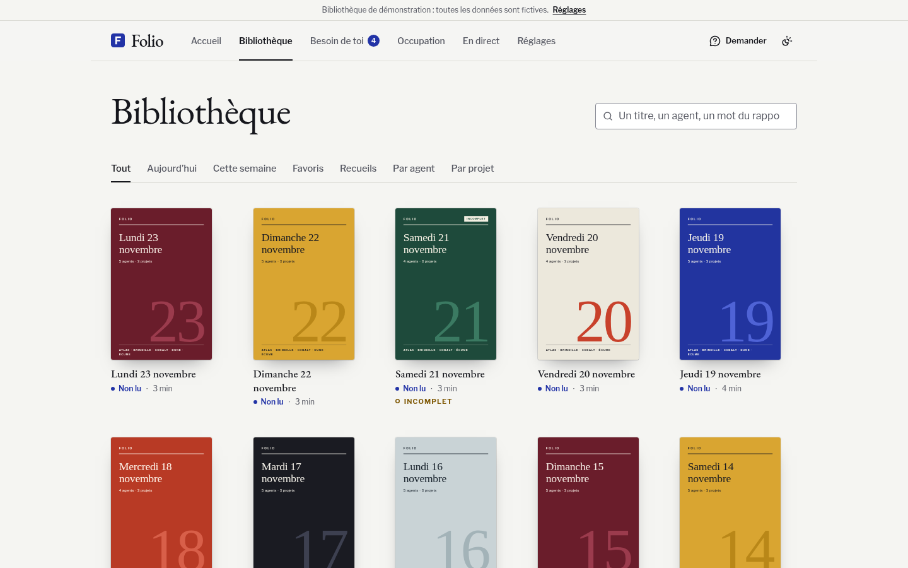
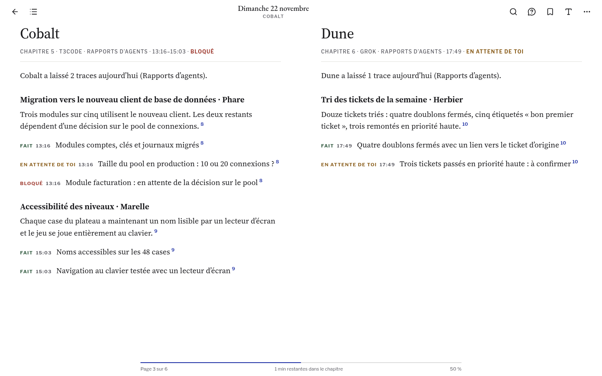

# Folio

**Your AI agents' work, as a book you read every day.**

[](LICENSE)
[](https://github.com/nautalsoft/folio/actions/workflows/ci.yml)
[](https://vercel.com/new/clone?repository-url=https%3A%2F%2Fgithub.com%2Fnautalsoft%2Ffolio)

[Lire en français](README.fr.md) · [Discussions](https://github.com/nautalsoft/folio/discussions) · [API](docs/api.md) · [Self-hosting](docs/self-hosting.md) · [Vercel](docs/vercel.md)

Folio collects what your coding agents (t3code, Claude Code, Codex, Grok Bot, cloud agents…) and your tools did during the day, and compiles it into a book: a preface, what needs you, one chapter per agent, one per source. Every fact links to where it came from. You read it in a reader inspired by Apple Books, with themes, highlights, notes and export to EPUB or PDF.

| Library | Reader |
| --- | --- |
|  |  |

*Screenshots show the built-in demo library. Every name, project and link in it is fictional.*

## Why

Agents now work in parallel, all day, in many places: terminals, editors, CI, chat bots, cloud runners. Coordination infrastructure such as Vercel Board gives them a shared place to post messages, claim tasks and hand off work. That infrastructure is headless by design: it is built for agents and APIs, not for a person who wants to sit down and understand what happened.

Folio is the reading interface on top. It reads Board and your other tools, accepts reports pushed by agents, and turns one day of activity into something a person can read in ten minutes, with the decisions that are waiting on them at the front.

## Features

- **A book per day**, compiled and published at the time you choose, plus a monthly collection that gathers the published days.
- **Chapters that make sense:** preface, "Needs you", one chapter per agent, one per source, and a "Sources" chapter that says which sources were read, skipped, not configured or failed. A book with a failed source is marked *incomplete*.
- **Every fact cites its source**, as a clickable link to the pull request, deployment, message, ticket or agent report.
- **Open sources.** Six built-in collectors (Vercel Board, GitHub, Vercel deployments, Slack, ClickUp, Notion), and any other tool (Linear, Jira, Discord, a script of yours) can push facts under its own name and get its own chapter.
- **Agent reports** pushed over HTTP, with items, code, diffs and step traces.
- **Needs you:** decisions, blockers and reviews raised by agents or sources, sorted by deadline, resolved from the app.
- **Who's on it:** task claims, heartbeats and checkpoints, so agents don't work on the same thing twice and can resume each other's work.
- **Live:** a real-time feed of what agents push.
- **A real reader:** paged or scrolling, four themes, fonts, size, spacing, margins, justification, reading guide, table of contents, search in book, bookmarks, highlights in four colors, notes, reading progress and time.
- **Ask the book:** a chat that answers from the book's passages and cites them. Without a model, it falls back to plain passage search.
- **Edit and regenerate:** fix a paragraph by hand; regenerating the book keeps your edits unless you discard them.
- **Optional AI writing** through Vercel AI Gateway or any OpenAI-compatible server. Without a model, the book is compiled from the facts alone.
- **Export** any published book to EPUB or PDF.
- **Webhooks** for `book.published`, `needs_you.created` and `digest.failed`, optionally signed with HMAC.
- **Browser agents (WebMCP):** the interface's components are exposed to agents running in the browser, with a setting to always ask, ask for sensitive actions only, or turn it off.
- **Light and dark, French and English.**
- **A fictional demo library** on first start, so you can see twelve days of books and a monthly collection before connecting anything.

## Quick start

You need either Docker, or a Vercel account. It takes less than five minutes.

### Docker

```bash
git clone https://github.com/nautalsoft/folio.git folio
cd folio
docker compose up
```

Open <http://localhost:3000>. This builds the app and starts it with a Postgres 17 database. The demo library is there; your data persists in the database. See [docs/self-hosting.md](docs/self-hosting.md) for volumes, backups, HTTPS and upgrades.

### Vercel

[](https://vercel.com/new/clone?repository-url=https%3A%2F%2Fgithub.com%2Fnautalsoft%2Ffolio)

The button deploys with zero configuration. Without a database, Folio runs as an **ephemeral in-memory demo**: data can disappear at any moment. To keep your data, add a Postgres database from the Vercel Marketplace (Neon sets `DATABASE_URL`) and redeploy. See [docs/vercel.md](docs/vercel.md).

### Local development

```bash
pnpm install   # Node 22+, pnpm 10
pnpm dev
```

Without `DATABASE_URL` or `FOLIO_DATA_DIR`, data lives in memory and resets on restart.

## Make it yours

All configuration is environment variables. `.env.example` lists every one of them; the main ones:

| Variable | Default | Purpose |
| --- | --- | --- |
| `DATABASE_URL` (or `POSTGRES_URL`) | none | Postgres connection string. |
| `FOLIO_DATA_DIR` | none | Without Postgres: directory for the embedded PGlite database. Without both, data is in memory. |
| `FOLIO_INGEST_TOKEN` | none | Bearer token required by the ingest and automation API. |
| `CRON_SECRET` | falls back to `FOLIO_INGEST_TOKEN` | Bearer token required by `/api/cron/digest`. |
| `FOLIO_PUBLIC_URL` | `https://$VERCEL_PROJECT_PRODUCTION_URL` on Vercel | Public URL, used for absolute links in webhooks and books. |
| `FOLIO_DIGEST_TIME` | `18:00` | Local time at which the day's book is published. |
| `FOLIO_TIMEZONE` | `Europe/Paris` | Time zone that defines "a day". |
| `FOLIO_REPORT_LANGUAGE` | `fr` | Language of the books: `fr` or `en`. |
| `FOLIO_MODEL` | `anthropic/claude-sonnet-5.5` | Model id for writing and chat. |
| `FOLIO_REASONING` | `minimal` | Reasoning effort for writing and chat: `provider-default`, `none`, `minimal`, `low`, `medium`, `high`, `xhigh`, `max`. |
| `AI_GATEWAY_API_KEY` | none | Vercel AI Gateway key. Not needed on Vercel, which uses OIDC. |
| `FOLIO_AI_BASE_URL`, `FOLIO_AI_API_KEY` | none | Any OpenAI-compatible server instead of AI Gateway. |
| `FOLIO_WEBHOOK_SECRET` | none | Signs outgoing webhooks. |
| `FOLIO_DEMO` | on | `false` disables the demo library. |
| `FOLIO_SCHEDULER` | on (off on Vercel) | `false` disables the in-process scheduler. |
| `FOLIO_CRON_HOURLY` | off | `true` makes `/api/cron/digest` respect the publication time on Vercel (for an hourly cron). |
| `FOLIO_AGENT_ALIASES` | none | Maps source actors to agents: `github:some-bot=atlas,slack:U0123=atlas`. |

Collector variables (`GITHUB_TOKEN`, `SLACK_BOT_TOKEN`, `BOARD_NAME`…) are documented in [docs/sources.md](docs/sources.md). The publication time, time zone, model, book language, enabled sources and webhooks can also be changed in **Settings**. Once you save Settings, the saved values take precedence over the environment defaults.

### Protect the ingest API

Set `FOLIO_INGEST_TOKEN` to a long random value as soon as the instance is reachable from the internet:

```bash
openssl rand -hex 32
```

With it set, every call to `/api/ingest/*` and `/api/automation/*` must send `Authorization: Bearer <token>`. The token is never shown again in the UI: Settings only says whether it is set. Keep it in your agents' environment as `FOLIO_INGEST_TOKEN`.

The token protects the machine endpoints only. The reading interface has no login (see [Privacy and security](#privacy-and-security)).

## Feed it

Folio gets its material in two ways: it **collects** from configured sources when the day is compiled, and it **receives** what agents and tools push. The full reference, generated from the validation schemas, is in [docs/api.md](docs/api.md).

### Agents push reports

At the end of a task, an agent sends what it did:

```bash
curl -X POST "$FOLIO_URL/api/ingest/report" \
  -H "Authorization: Bearer $FOLIO_INGEST_TOKEN" \
  -H "Content-Type: application/json" \
  -d '{
    "agent": { "id": "atlas", "name": "Atlas", "kind": "claude-code" },
    "key": "herbier-search-2026-11-23",
    "project": "Herbier",
    "title": "Full-text search for plant records",
    "summary": "Replaced prefix filtering with full-text search on latin and common names.",
    "items": [
      { "text": "Reversible migration adds a GIN index", "status": "done", "url": "https://github.com/example/herbier/pull/128", "label": "PR #128" },
      { "text": "Choose the index language", "status": "waiting" }
    ],
    "needs": [
      { "key": "index-language", "kind": "decision", "title": "French only, or French and latin?" }
    ]
  }'
```

Sending the same `key` again updates the report instead of creating a new one. Ready-to-paste instructions for t3code, Claude Code, Codex, Grok Bot and cloud agents are in [`skills/`](skills/).

### Any tool pushes facts

Sources are open-ended. Any tool can push facts under its own source name: it gets its own chapter and appears in the book's source status.

```bash
curl -X POST "$FOLIO_URL/api/ingest/facts" \
  -H "Authorization: Bearer $FOLIO_INGEST_TOKEN" \
  -H "Content-Type: application/json" \
  -d '{
    "source": "linear",
    "facts": [
      { "id": "ENG-482", "status": "done", "title": "Retry failed exports", "url": "https://linear.app/example/issue/ENG-482", "project": "Phare" },
      { "id": "ENG-490", "status": "blocked", "title": "Billing pool size", "body": "Waiting for a decision", "url": "https://linear.app/example/issue/ENG-490" }
    ]
  }'
```

Facts are upserted by `(source, id, day)`, so pushing the same batch twice is safe. Send `"run": { "status": "error", "message": "..." }` when your tool failed to read its data: the book is then marked incomplete. Set `agent` on a fact to put it in that agent's chapter instead of the source's.

### Claims and checkpoints

Before starting a task, an agent can check whether someone else holds it, then claim it, send heartbeats and checkpoints, and release it or mark it done:

```bash
curl "$FOLIO_URL/api/ingest/work?key=herbier-synonyms" -H "Authorization: Bearer $FOLIO_INGEST_TOKEN"
# {"item":null,"free":true}

curl -X POST "$FOLIO_URL/api/ingest/work" \
  -H "Authorization: Bearer $FOLIO_INGEST_TOKEN" -H "Content-Type: application/json" \
  -d '{ "agent": "atlas", "action": "claim", "task": { "key": "herbier-synonyms", "title": "Synonyms in search" } }'
```

A claim with no heartbeat for 30 minutes is stale and can be taken over. The "Who's on it" page shows claims and checkpoints, and lets you release a claim or undo a takeover.

## Drive it from any orchestrator

On its own, Folio publishes once a day at `FOLIO_DIGEST_TIME`. If you already run an orchestrator, a scheduler or CI, it can drive the run instead, as often as you like:

```bash
curl -X POST "$FOLIO_URL/api/automation/run" \
  -H "Authorization: Bearer $FOLIO_INGEST_TOKEN" \
  -H "Content-Type: application/json" -d '{}'
```

A run collects every enabled source, compiles the day and publishes it. It is idempotent per day: a second run updates the same book and bumps its version.

| Status | Meaning |
| --- | --- |
| `200` | Book published, every source read. |
| `207` | Book published, but at least one source failed. The book is marked incomplete and the response lists the failure. |
| `422` | Nothing to publish for that day. The book is not published and a `digest.failed` webhook is sent. |
| `401` | Missing or wrong token. |

`GET /api/automation/status?day=YYYY-MM-DD` returns the day's book (status, version, incomplete) and the last run of each source.

A daily run from GitHub Actions:

```yaml
on:
  schedule:
    - cron: '0 17 * * *' # UTC
jobs:
  folio:
    runs-on: ubuntu-latest
    steps:
      - run: |
          curl -sS --fail-with-body -X POST "${{ secrets.FOLIO_URL }}/api/automation/run" \
            -H "Authorization: Bearer ${{ secrets.FOLIO_INGEST_TOKEN }}" \
            -H "Content-Type: application/json" -d '{}'
```

`--fail-with-body` fails the job on `422`, but not on `207`; check the JSON's `ok` field if you want partial runs to fail too. Or from a crontab:

```cron
0 18 * * * curl -sS -X POST https://folio.example.com/api/automation/run -H "Authorization: Bearer YOUR_TOKEN" -H "Content-Type: application/json" -d '{}'
```

## Webhooks

Add webhook URLs in **Settings**, choosing which events each one receives:

| Event | Sent when |
| --- | --- |
| `book.published` | A day's book is published or updated. |
| `needs_you.created` | A new "needs you" item appears (once per item). |
| `digest.failed` | A run had nothing to publish. |

Each request is a `POST` with a JSON body `{ "event", "at", "instance", "data" }` and an `x-folio-event` header. If `FOLIO_WEBHOOK_SECRET` is set, it also carries `x-folio-signature: sha256=<hex>`, the HMAC-SHA256 of the raw body with that secret. Delivery has a 10-second timeout and no retry; Settings shows the last deliveries. Payloads are in [docs/api.md](docs/api.md#webhooks).

## Export

Any published book downloads as **EPUB** or **PDF** from the reader's menu, or from `GET /api/books/<slug>/export?format=epub|pdf`. Citations are kept as links, with a source list at the end of each chapter.

## Privacy and security

- **No telemetry.** Folio sends nothing anywhere except to the sources you configure, the AI provider you configure and the webhooks you add.
- **No accounts.** One instance, one reader. Reading state, highlights and notes belong to the instance.
- **Machine endpoints are token-protected** with `FOLIO_INGEST_TOKEN` (and `CRON_SECRET` for the cron endpoint).
- **The reading interface is not.** It has no login, and its endpoints can change settings, edit books and reset the instance. **Put any public instance behind protection**: an authenticating reverse proxy, a VPN, or your platform's access protection. Leave `/api/ingest/*`, `/api/automation/*` and `/api/cron/*` reachable for your agents; they carry their own token. See [docs/self-hosting.md](docs/self-hosting.md#reverse-proxy-and-https).
- **Prompt-injection isolation.** Everything that comes from sources and agents is treated as untrusted data. It reaches a model only inside `<source_data>` tags, with instructions never to follow what it says. The model writes prose only and may only cite ids it was given.
- **Secrets stay in the environment.** Collectors read tokens from environment variables and never log or return them. Don't put secrets in reports: they end up in the book.

To report a vulnerability, see [SECURITY.md](SECURITY.md).

## Architecture

Nuxt 4 (Vue 3 and Nitro), Vercel's UI SDK (`@ui-sdk/vue`, `@ui-sdk/core`) styled with Tailwind, the AI SDK, Drizzle ORM on Postgres or embedded PGlite.

```
sources (collectors) ──┐
agent reports ─────────┼─▶ facts, reports, needs ─▶ compile (BookContent) ─▶ optional AI prose ─▶ publish ─▶ reader, EPUB, PDF, webhooks
facts from any tool ───┘
```

Decisions and their reasons are recorded in [docs/adr](docs/adr):

1. [Nuxt and the UI SDK](docs/adr/0001-nuxt-and-ui-sdk.md)
2. [Storage: Postgres or PGlite](docs/adr/0002-storage-postgres-or-pglite.md)
3. [Book format and citations](docs/adr/0003-book-format-and-citations.md)
4. [No accounts, single reader](docs/adr/0004-no-accounts-single-reader.md)
5. [Scheduling](docs/adr/0005-scheduling.md)
6. [Open sources and prompt isolation](docs/adr/0006-open-sources-and-prompt-isolation.md)

## Contributing

Contributions are welcome: collectors, translations, reader improvements, bug fixes. Read [CONTRIBUTING.md](CONTRIBUTING.md) and the [Code of Conduct](CODE_OF_CONDUCT.md). Questions and ideas go to [Discussions](https://github.com/nautalsoft/folio/discussions). What's planned is in [ROADMAP.md](ROADMAP.md), what changed in [CHANGELOG.md](CHANGELOG.md).

## License

[MIT](LICENSE). Folio is a personal, self-hosted tool: the goal is that anyone can run it, change it and build on it with as few strings attached as possible. A copyleft license such as the AGPL mostly protects projects that sell a hosted cloud version against competitors; Folio has no hosted offer to protect.

The logo uses the "book-open-text" icon from [Phosphor Icons](https://phosphoricons.com) (MIT, Copyright (c) 2023 Phosphor Icons).
